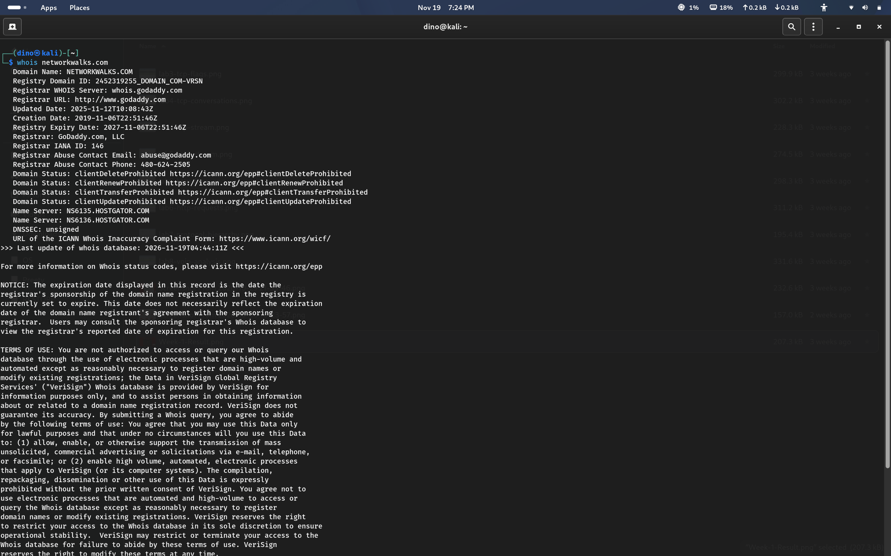
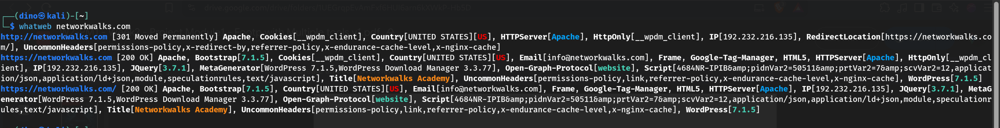
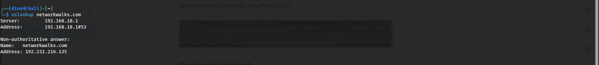
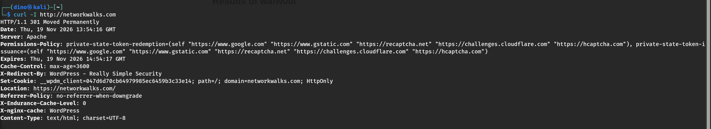
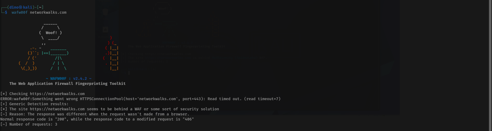
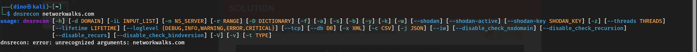
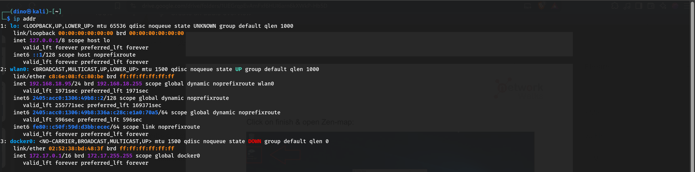
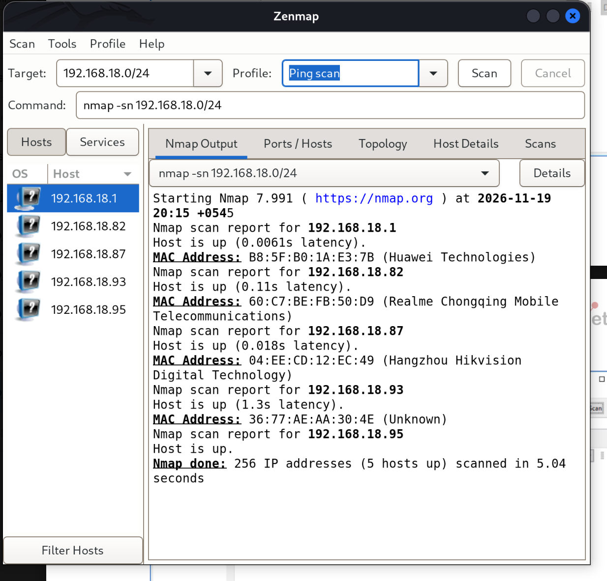
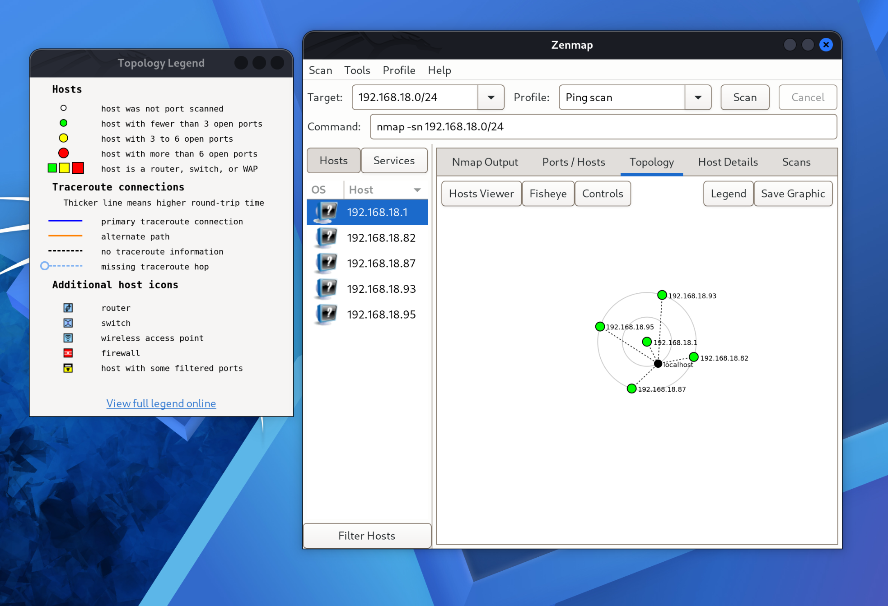

# NetworkWalks Week 2 - Penetration Testing Report

**Footprinting and Network Scanning**  
Networkwalks Cybersecurity & Ethical Hacking Internship · W2-PM-FINAL

| Project detail | Information |
| --- | --- |
| Prepared by | Preety Rauniyar |
| Program and batch | Networkwalks Cybersecurity & Ethical Hacking · B084 |
| Report date | 14th November |
| Modules | W2-PM1 (Kali Linux footprinting) and W2-PM5 (Zenmap network discovery) |
| PM1 scope | networkwalks.com |
| PM5 scope | 192.168.18.0/24 |

## 1. Liability Disclaimer and Scope

This report is for the Networkwalks Week 2 training assignment. The approved testing scope and basis for authorization are recorded. The report covers footprinting and local network discovery. Any observation about a technology, DNS record, or discovered device should be read in the context of the evidence captured for that activity.

## 2. Introduction

W2-PM1 examines the information visible about an approved domain through registration records, DNS, web responses, technology identification, and WAF detection. W2-PM5 documents device discovery on an authorized local network and presents the result as an inventory and a topology diagram. The report records the procedure, findings, and supporting evidence for each module.

## 3. Tools Used

| Tool or environment | Purpose |
| --- | --- |
| Kali Linux | Environment for the footprinting tasks |
| WHOIS | Review domain registration details and name servers |
| WhatWeb | Identify visible website technologies |
| Nslookup | Resolve the domain and record the returned IP addresses |
| cURL | Review HTTP response headers |
| Wafw00f | Record the tool's WAF detection result |
| DNSRecon | Review DNS records returned by the tool |
| Zenmap | Review local host discovery results and export a network topology |

## 4. Activities Performed

### 4.1 W2-PM1 · Footprinting and Reconnaissance

For each task, record the command you actually used and the relevant lines from its output. Screenshots and saved text outputs are indexed in Section 8.

| Task | Command used | Observed result |
| --- | --- | --- |
| 1. Domain registration (WHOIS) | whois networkwalks.com | The result provided information about the domain registration and hosting infrastructure. |
| 2. Web technologies (WhatWeb) | whatweb networkwalks.com |  The result identified WordPress 7.1.5 and JQuery 3.7.1, along with other information exposed by the website. |
| 3. Name resolution (Nslookup) | nslookup networkwalks.com | The provided result identified 192.232.216.135 |
| 4. HTTP headers (cURL) | curl -I https://networkwalks.com | This provided additional information about the web application and exposed the WordPress REST API endpoint /wp-json/ |
| 5. WAF detection (Wafw00f) | wafw00f networkwalks.com | The result identified ModSecurity (SpiderLabs). |
| 6. DNS records (DNSRecon) | dnsrecon networkwalks.com | The result provided information relating to name servers, mail servers, SPF/TXT records, service records and DNS software information |

### 4.2 W2-PM5 · Network Scanning with Zenmap

| Task | Result |
| --- | --- |
| 1. Zenmap installation | Version: 7.991 |
| 2. Local IP address and subnet | Local IP address: 192.168.18.95, subnet mask: 255.255.255.0 and CIDR : /24|
| 3. Live host discovery | Command used: nmap -sn 192.168.18.0/24 |
| 4. Number of live hosts | 5 live hosts found (including my PC)  |
| 5. Live host IP addresses | See the host inventory below. |
| 6. Live host MAC addresses | See the host inventory below. |
| 7. Network topology | see the screenshot |

| Host | IPv4 address | MAC address | Device or observation |
| --- | --- | --- | --- |
| 1 | 192.168.18.1 | Unavailable |                |
| 2 | 192.168.18.82 | B8:5F:B0:1A:E3:7B | Huawei Technologies |
| 3 | 192.168.18.87 | 60:C7:BE:FB:50:D9 | Realme Chongqing Mobile Telecommunications |
| 4 | 192.168.18.93 | 04:EE:CD:12:EC:49 | Hangzhou Hikvision Digital Technology |
| 5 | 192.168.18.95 | 36:77:AE:AA:30:4E | Unknown |

## 5. Risk Analysis and Impact

| Finding | Evidence or observation | Potential impact | Risk level |
| --- | --- | --- | --- |
| Website technology visibility | WhatWeb identified WordPress and JQuery | Attackers may use exposed technology/version information to identify software requiring further security review | Medium |
| DNS and infrastructure visibility | DNSRecon identified DNS, mail and service-related records | DNS information can help build a broader infrastructure profile | Medium |
| WAF identification | Wafw00f identified ModSecurity (SpiderLabs) | Reveals information about the web application’s security architecture | Low |
| Local device inventory | Zenmap identified five live hosts in the network | Unknown or unauthorized devices may potentially be present on a network | Medium |

## 6. Recommendations

Based on the observations from these activities, I recommend the following security improvements:

- **Website technologies and headers.** Review the software and header details recorded in PM1. Confirm that any visible components are maintained and that published technical details serve a purpose.
- **DNS and WAF configuration.** Check that observed DNS records match their intended use. Where a WAF was identified, review its configuration and monitoring as part of routine maintenance.
- **Local network inventory.** Compare the discovered hosts with the expected device list. Verify any unidentified device and update the topology and inventory as needed.
- **Perform security testing with authorization.** Reconnaissance and scanning should only be performed against systems and networks where appropriate authorization has been provided.

## 7. Conclusion

In the footprinting exercise, I used six Kali Linux tools to collect information about the target domain. I learned how WHOIS can provide domain information, WhatWeb can identify web technologies, Nslookup can resolve domain names, Curl can inspect HTTP headers, Wafw00f can identify a WAF, and DNSRecon can provide additional DNS information.
The Zenmap exercise identified 5 live hosts on 192.168.18.0/24 and produced a topology diagram. 

I also learned that technical findings should be documented clearly. A good cybersecurity report should explain what was performed, what was discovered, what the observation means, what risk it may create, and what can be done to reduce that risk.
Finally, I learned that reconnaissance and scanning must always be performed within an authorized scope.

## 8. Evidence Collected

### W2-PM1 · Kali Linux Footprinting

**Figure 1. WHOIS output** 

**Figure 2. WhatWeb output** 

**Figure 3. Nslookup output** 

**Figure 4. HTTP response headers** 

**Figure 5. WAF detection output** 

**Figure 6. DNSRecon output** 

### W2-PM5 · Zenmap Network Discovery

**Figure 7. Local IP address and subnet**

**Figure 8. Live hosts and IP addresses**

**Figure 9. MAC address evidence**

**Figure 10. Network topology with legend** 

